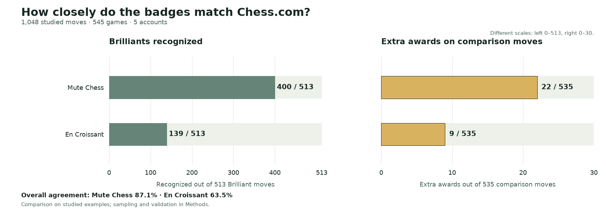
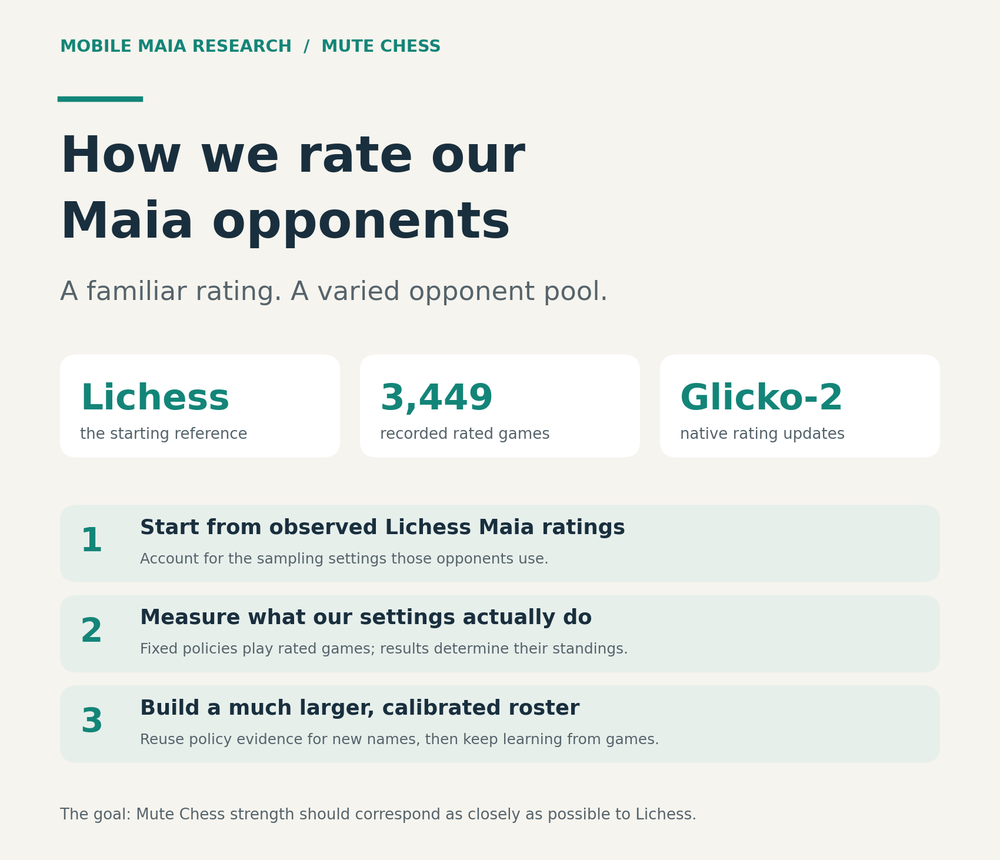

# Mute Chess research

Readable studies, visual explanations and the evidence behind Mute Chess's design decisions.

## Brilliant moves: more genuine ideas, fewer undeserved badges

**[Read: Making Brilliant badges feel at home on Mute Chess →](studies/brilliant-moves/REPORT.md)**

We recommend **Mute Selective: a small model we trained on chess moves labeled by Chess.com, combined with basic chess checks**. Your browser downloads it with the analysis code and runs it locally, using Stockfish evaluations and facts about the position. There is no ChatGPT or remote classification call, and it does not learn during play. En Croissant uses developer-written rules for its badge; our model learns patterns from Chess.com’s labels.

Across **400 test moves from 215 games not used for training**, it recognized **112 of 200 Chess.com Brilliants**, compared with En Croissant’s 53. Both gave **3 undeserved badges among 200 non-Brilliant moves**.

The more generous History Rule found more Brilliants but gave too many wrong badges to justify choosing it: on the same 200 moves, **78 correct and 13 wrong**, versus the selective model’s **57 correct and 2 wrong**. Our next goal is to train improved versions on more labeled examples while keeping wrong awards low. We can reuse the current test examples for training, then check improvement on different games the new model has never seen.

The model and training code are openly published. The separate History Rule and recovery guard are comparison methods, not extra requirements for Mute Selective. Mute Dev handles the app merge. Mobile Maia remains unchanged.

[Exact selected algorithm](studies/brilliant-moves/README.md) · [Methods and limits](studies/brilliant-moves/METHODS.md) · [Test move evidence](studies/brilliant-moves/data/selective-independent-moves.csv)

## Elo seeding: giving human-like opponents useful starting ratings

**[Read the illustrated Elo report →](studies/elo-seeding/REPORT.md)** · **[How the 10,000-opponent catalog is assigned →](studies/elo-seeding/CATALOG-METHOD.md)**

Two historical studies contain **3,449 rated games**, reference-policy establishment and the method behind the initial catalog. Maia's conditioning input is distinct from a measured playing rating. New identities reuse estimates for matching measured policies; Glicko-2 then updates their ratings through play.

The complete study directories were copied byte for byte from [mobile-maia-research at 140e2eb](https://github.com/Dash1971/mobile-maia-research/tree/140e2eb411923930fb0d5950b92abf6f3c0166dd). Reader copies adapt links for this repository. [Transfer provenance](SOURCE-PROVENANCE.json) records every archived source blob and SHA-256 digest. Their deployment descriptions describe the original study date, not a fresh audit of the live service.

## Evidence and attribution

Each study separates observations, interpretations and recommendations. Public game records, source pins, limitations and reproduction material accompany the reports. No authenticated session data or raw cookie-bearing response metadata is published.

The original [AGPL-3.0-only license](LICENSE) is retained for the copied research. Third-party code and visual evidence retain their own attribution and licensing; see the brilliant study's [reference notes](studies/brilliant-moves/reference/README.md). Reports and preparation used OpenAI Codex assistance. This repository is independent of Chess.com, Lichess and En Croissant.
