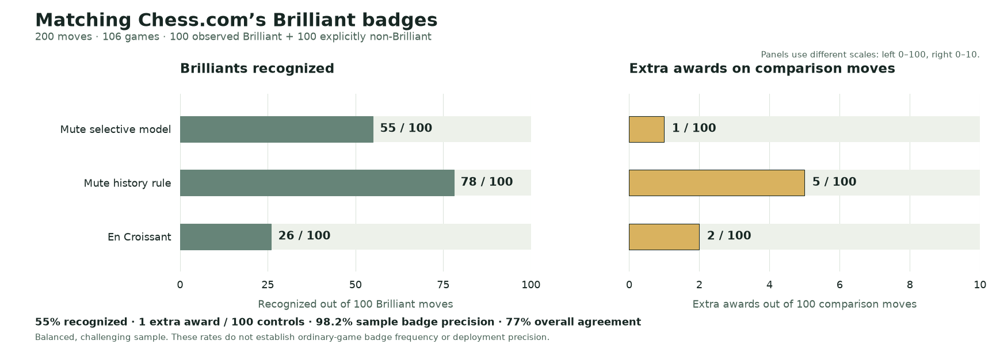

# Mute Chess research

Readable studies, visual explanations and the evidence behind Mute Chess's design decisions.

## Brilliant moves: what deserves the badge?

**[Read: When should a move earn Brilliant? →](studies/brilliant-moves/REPORT.md)**

Our selective candidate recognized **55 of 100 Chess.com Brilliants**, compared with En Croissant’s 26, and made **1 extra award among 100 controls**, versus 2. That is about **2.1 times as many recognized Brilliants, with fewer extra awards in this test**. Its 55% recognition and 77% overall agreement belong beside its 98.2% sample badge precision (55/56 awards; descriptive 95% interval 90.6–99.7%). It misses 45 Brilliants; this is no 90% agreement claim.

The unified study separates **848 development moves from 439 games** and a **fresh 200-move test from 106 games**: **1,048 moves / 545 games** across five accounts. The separate history rule recognizes 78/100 with 5 extra awards. These balanced, challenging samples do not establish ordinary-game frequency or deployment precision.

Native TypeScript has matching reference outputs on the 1,048 recorded SF18 inputs. **SF19 and changing browser budgets remain unvalidated; no merge or deployment is claimed. Mobile Maia remains unchanged.**

[Exact algorithm](studies/brilliant-moves/README.md) · [Methods and sources](studies/brilliant-moves/METHODS.md) · [Move-level evidence](studies/brilliant-moves/moves.csv) · [Earlier 618-move report](https://github.com/Dash1971/mute-chess-research/blob/c6969d1/studies/brilliant-moves/REPORT.md)

## Elo seeding: giving human-like opponents useful starting ratings

**[Read the illustrated Elo report →](studies/elo-seeding/REPORT.md)** · **[How the 10,000-opponent catalog is assigned →](studies/elo-seeding/CATALOG-METHOD.md)**

Two historical studies contain **3,449 rated games**, reference-policy establishment and the method behind the initial catalog. Maia's conditioning input is distinct from a measured playing rating. New identities reuse estimates for matching measured policies; Glicko-2 then updates their ratings through play.

The complete study directories were copied byte for byte from [mobile-maia-research at 140e2eb](https://github.com/Dash1971/mobile-maia-research/tree/140e2eb411923930fb0d5950b92abf6f3c0166dd). Reader copies adapt links for this repository. [Transfer provenance](SOURCE-PROVENANCE.json) records every archived source blob and SHA-256 digest. Their deployment descriptions describe the original study date, not a fresh audit of the live service.

## Evidence and attribution

Each study separates observations, interpretations and recommendations. Public game records, source pins, limitations and reproduction material accompany the reports. No authenticated session data or raw cookie-bearing response metadata is published.

The original [AGPL-3.0-only license](LICENSE) is retained for the copied research. Third-party code and visual evidence retain their own attribution and licensing; see the brilliant study's [reference notes](studies/brilliant-moves/reference/README.md). Reports and preparation used OpenAI Codex assistance. This repository is independent of Chess.com, Lichess and En Croissant.

## Archived studies

The [feasibility study](studies/brilliant-moves-pilot-2026-11-03/REPORT.md), [tactical reference positions](studies/brilliant-moves-followup-2026-11-03/README.md) and [development-reference release](studies/brilliant-moves-2026-11-03/REPORT.md) remain available with their original denominators. Use the unified report above for the complete current comparison.
