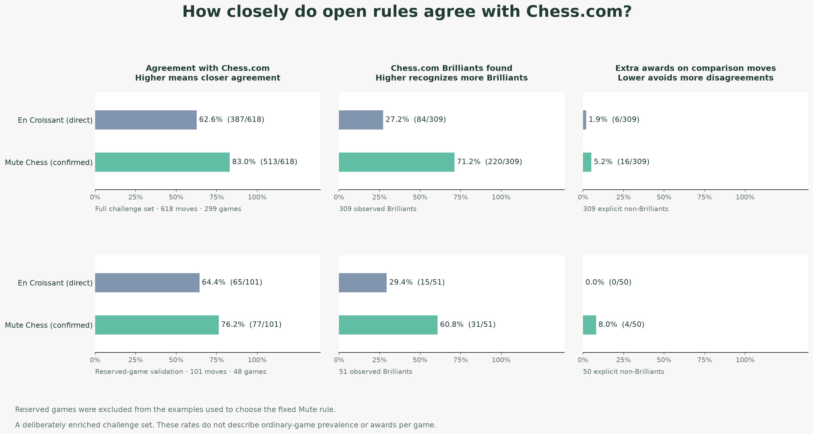

# Mute Chess research

Readable studies, visual explanations and the evidence behind Mute Chess's design decisions.

## Brilliant moves: what deserves the badge?

**[Read: What makes a move brilliant? →](studies/brilliant-moves/REPORT.md)**

We compared **618 explicitly reviewed moves from 299 games**, evenly divided between Chess.com Brilliants and non-Brilliants. Mute's proposed rule agrees with **83.0%** of those labels, versus **62.6%** for En Croissant. On separately reserved games, agreement is **76.2% versus 64.4%**.

Mute recognizes **220 of 309** Chess.com Brilliants, about **2.6 times** En Croissant's 84. It also gives **16 extra awards**, versus En Croissant's 6. The illustrated report shows quiet sacrifices, material recovered on other squares, and the open rules behind those decisions.

The proposed material guard reduces Mute's extra awards **from 77 to 16**, while recognition falls **from 273 to 220**. On reserved games the guard reduces overall agreement relative to the more generous Mute rule. This is an explicit choice about badge quality; these selected-sample rates do not describe ordinary-game award frequency. **Mobile Maia remains unchanged.**

[Exact methods and open evidence](studies/brilliant-moves/METHODS.md) · [Move-by-move results](studies/brilliant-moves/moves.csv) · [Proposed Mute change](https://github.com/Dash1971/mute-chess/pull/231)

## Elo seeding: giving human-like opponents useful starting ratings

**[Read the illustrated Elo report →](studies/elo-seeding/REPORT.md)** · **[How the 10,000-opponent catalog is assigned →](studies/elo-seeding/CATALOG-METHOD.md)**

Two historical studies contain **3,449 rated games**, reference-policy establishment and the method behind the initial catalog. Maia's conditioning input is distinct from a measured playing rating. New identities reuse estimates for matching measured policies; Glicko-2 then updates their ratings through play.

The complete study directories were copied byte for byte from [mobile-maia-research at 140e2eb](https://github.com/Dash1971/mobile-maia-research/tree/140e2eb411923930fb0d5950b92abf6f3c0166dd). Reader copies adapt links for this repository. [Transfer provenance](SOURCE-PROVENANCE.json) records every archived source blob and SHA-256 digest. Their deployment descriptions describe the original study date, not a fresh audit of the live service.

## Evidence and attribution

Each study separates observations, interpretations and recommendations. Public game records, source pins, limitations and reproduction material accompany the reports. No authenticated session data or raw cookie-bearing response metadata is published.

The original [AGPL-3.0-only license](LICENSE) is retained for the copied research. Third-party code and visual evidence retain their own attribution and licensing; see the brilliant study's [reference notes](studies/brilliant-moves/reference/README.md). Reports and preparation used OpenAI Codex assistance. This repository is independent of Chess.com, Lichess and En Croissant.

## Archived studies

The [feasibility study](studies/brilliant-moves-pilot-2026-11-03/REPORT.md), [tactical reference positions](studies/brilliant-moves-followup-2026-11-03/README.md) and [development-reference release](studies/brilliant-moves-2026-11-03/REPORT.md) remain available with their original denominators. Use the unified report above for the complete current comparison.
