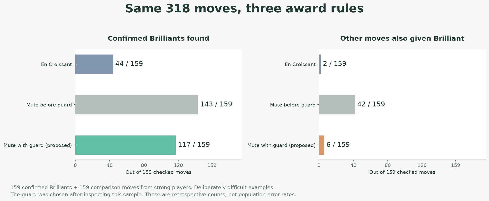

# Mute Chess research

Readable studies, visual explanations and the evidence behind Mute Chess's design decisions.

## Brilliant moves: celebrating sacrifices without praising every trade

**[Read: What makes a move brilliant? →](studies/brilliant-moves-2026-11-03/REPORT.md)**

We compared **318 moves from 153 games**: 159 displayed Chess.com Brilliants and 159 explicitly non-brilliant moves. The illustrated report shows quiet sacrifices, ordinary pawn-winning combinations and the rules a program can use to distinguish them.

On this deliberately challenging sample, proposed Mute rules reduce extra Brilliant awards **from 42 to 6**, while recognizing **117 of 159** Chess.com Brilliants instead of 143. En Croissant recognizes 44, with 2 extra awards. The report explains this tradeoff openly; these are retrospective sample counts, not ordinary-game error rates. **Mobile Maia remains unchanged.**

[Exact methods and open evidence](studies/brilliant-moves-2026-11-03/METHODS.md) · [Proposed Mute change](https://github.com/Dash1971/mute-chess/pull/231)

Earlier evidence remains available: the [40-move feasibility pilot](studies/brilliant-moves-pilot-2026-11-03/REPORT.md) and [pawn-winning follow-up](studies/brilliant-moves-followup-2026-11-03/README.md). Their findings and recommendations describe those earlier samples.

## Elo seeding: giving human-like opponents useful starting ratings

**[Read the illustrated Elo report →](studies/elo-seeding/REPORT.md)** · **[How the 10,000-opponent catalog is assigned →](studies/elo-seeding/CATALOG-METHOD.md)**

Two historical studies contain **3,449 rated games**, reference-policy establishment and the method behind the initial catalog. Maia's conditioning input is distinct from a measured playing rating. New identities reuse estimates for matching measured policies; Glicko-2 then updates their ratings through play.

The complete study directories were copied byte for byte from [mobile-maia-research at 140e2eb](https://github.com/Dash1971/mobile-maia-research/tree/140e2eb411923930fb0d5950b92abf6f3c0166dd). Reader copies adapt links for this repository. [Transfer provenance](SOURCE-PROVENANCE.json) records every archived source blob and SHA-256 digest. Their deployment descriptions describe the original study date, not a fresh audit of the live service.

## Evidence and attribution

Each study separates observations, interpretations and recommendations. Public game records, source pins, limitations and reproduction material accompany the reports. No authenticated session data or raw cookie-bearing response metadata is published.

The original [AGPL-3.0-only license](LICENSE) is retained for the copied research. Third-party code and visual evidence retain their own attribution and licensing; see the brilliant study's [reference notes](studies/brilliant-moves-2026-11-03/reference/README.md). Reports and preparation used OpenAI Codex assistance. This repository is independent of Chess.com, Lichess and En Croissant.
