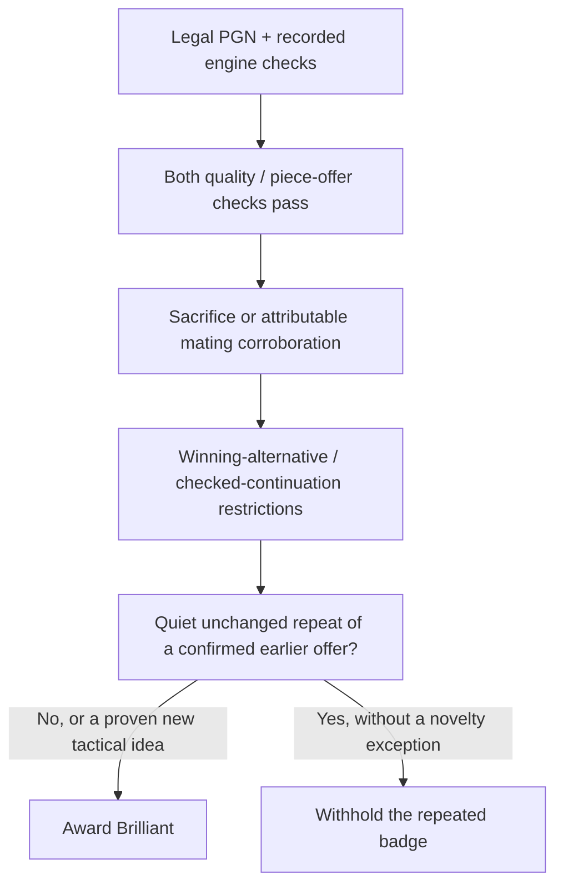
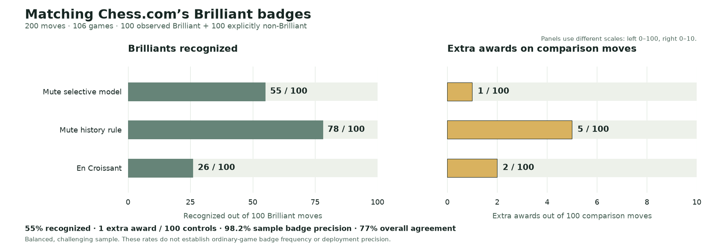
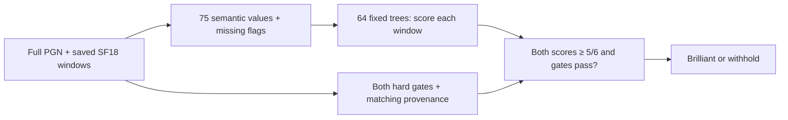

# Mute History Rule with material recovery: exact algorithm

**Current decision: adopt the Mute History Rule with its material-recovery guard, and continue improving false-award behavior.** On 200 fresh moves from 109 games, the unchanged rule and core rule each give 78TP/22FN/13FP/87TN (82.5% agreement), versus direct En Croissant 27/73/1/99 (63.0%). Thirteen false awards among 100 controls remain an important limit and a target for further refinement. There was no guard-specific decision difference. The combined 1,248-move/654-game descriptive counts are 478/135/35/600 (86.4%) versus EC 166/447/10/625 (63.4%). Combined totals include development examples and must not replace the fresh-test estimate. [New evidence and audits](data/prospective-history/PRIMARY-AUDIT.json) and [combined move-level results](data/combined-history-results.json) accompany the update.


**Recommendation: adopt the History Rule with its material-recovery guard, with the measured limits below.** The refinement keeps 400 matched Brilliants and removes exactly two extra awards in the 1,048-move replay: **400TP / 113FN / 22FP / 513TN**, versus unrefined S 400/113/24/511. No other decision changed and no guard proof was unknown. The guard was designed after inspecting these labels: **all 1,048 examples described in this historical replay are development; the new separate 200-move check is reported above**. Historical independent evidence for the unrefined rule is preserved below; its old test cannot become a new untouched test for this guard. This is an adoption recommendation, not a deployment/native SF19 validation claim. Mobile Maia remains unchanged.

[Refinement outcomes and certificates](data/history-recovery-results.json), [independent legal/material audit](data/history-recovery-audit.json), [frozen guard plan](data/history-recovery-plan.json) and [source/path mapping](reference/history-recovery/SOURCE-MAPPING.json) define the retrospective result.

## Historical independent test of the unrefined History Rule

| Frozen test, before the new guard | Preserved result |
| --- | --- |
| Moves / games | 200 / 106 |
| Observed Brilliant / explicitly non-Brilliant | 100 / 100 |
| **Unrefined frozen S: TP / FN / FP / TN** | **78 / 22 / 5 / 95** |
| Direct En Croissant: TP / FN / FP / TN | 26 / 74 / 2 / 98 |
| A and v4, each TP / FN / FP / TN | 78 / 22 / 6 / 94 |
| Selective forest, comparison only | 55 / 45 / 1 / 99 |
| EC with shared-window confirmation | 26 / 74 / 2 / 98 |

S has **78% recognition**, **86.5% agreement** and **78/83 = 93.98% sample badge precision**. Its descriptive Wilson 95% intervals are 68.93–85.00% recognition, 81.07–90.55% agreement, 86.66–97.40% sample badge precision and 2.15–11.18% extra-control rate. The five extras exceed En Croissant’s two; no 90% agreement target is claimed achieved. These figures apply to S without the added guard. On the same 200 moves the refined result is 78/22/3/97, but this is retrospective reuse—not independent validation of the refinement. The forest remains a comparison appendix, not a second recommendation.

The unified corpus has **1,048 moves from 545 games**: **848 development moves / 439 games** (413 Brilliants, 435 non-Brilliants) and a separate **200-move test / 106 games** (100 per class). Each of five accounts contributes 20 per class to the fresh test. For unrefined S and the original comparators, sources, model/rules, thresholds and extraction were fixed before those current labels. The added guard was designed afterward; the entire corpus is now development evidence for that refinement.

[Full predictions and intervals](data/test-results.json), [compact move evidence](moves.csv), [source/identity audit](data/protocol/FINAL-AUDIT.json) and [test freeze](data/protocol/CORE-FREEZE.json) accompany the result. Core-freeze SHA-256: `99bcffb5a77209f13e61bd0c495625950da6950c028ab9b64a5a1b8eea6a3394`.

| Account | History Rule recognized / extra awards | EC direct recognized / extra awards | Selective forest recognized / extra awards |
| --- | ---: | ---: | ---: |
| GothamChess | 16 / 0 | 7 / 0 | 12 / 0 |
| Hikaru | 11 / 0 | 3 / 0 | 9 / 0 |
| KNVB | 16 / 0 | 9 / 0 | 8 / 0 |
| hansen | 17 / 3 | 5 / 1 | 13 / 1 |
| nelsi | 18 / 2 | 2 / 1 | 13 / 0 |

Each account has 20 positives and 20 controls; the two columns use different class denominators. Zero observed extras is not a zero-risk guarantee. Per-account Wilson intervals remain in the saved results.

## Shared inputs, scoring and legal offers

Inputs are a full legal standard-chess PGN, a target one-based ply, and ordered engine snapshots for the previous own-after position, before-position and after-position. Near the start, duplicate initial positions are removed. Snapshots contain exact FEN, explicit engine/configuration provenance, current and actual preceding completed iterations, terminal state, score and legal UCI principal variations.

The validated extraction domain is the pinned **SF18**, **300,000 requested nodes**, **Threads 1**, **Hash 64 MB**, **MultiPV 2 where two legal roots exist**, full PGN history and the recorded complete-iteration convention. The extractor verifies target/PV legality and position identity. A matching provenance string alone cannot prove that a caller really used the declared engine/options.

Native SF19, varying browser depths/budgets, other engines and changed MultiPV are outside this validation. Castling, en passant and promotion have legal feature/abstention fixtures, but none occurs among the 848 development cases. The special-move fixtures establish legal handling, not empirical accuracy for those move types. Forest-specific calibration limits are retained in its comparison appendix. Other variants are unsupported.

### Shared quality and offer gates

Scores are normalized to the mover. Let

```text
C(score, mover) = clamp(mover-relative centipawns, -1000, +1000)
                 or 1000 × sign(mover-relative mate distance)
W(c) = 100 / (1 + exp(-0.00368208 × c))
loss_w = W(best before-position score_w) - W(best after-position score_w)
```

Mate 0 maps to 0. The after-position search is the position after the played move. The quality gate uses that child-position score, not an invented before-search score for an unsearched played root. W is a scoring heuristic, not a calibrated human winning probability.

For **each** current/prior completed analysis window:

```text
eligible_w = before-root-count_w >= 2
             AND raw_piece_offer(before, after)
             AND loss_w <= 5
             AND C(after_w, mover) >= -100
```

The raw offer test is unchanged: the after-position is nonterminal, and some opponent legal capture/exchange on a knight, bishop, rook or queen has static exchange gain **strictly greater** than

```text
max(0, physical mover material_after - physical mover material_before) + 100.
```

Values are pawn 90, knight 300, bishop 300, rook 500, queen 1000, king 0. Capture/promotion gains are credited. The piece offered need not be the piece moved. The one-square exchange evaluator considers legal captures and permits stopping; it is a local material heuristic, including its stop convention in check, not a proof over all legal continuations. The frozen raw-offer recursion has no explicit node cap.


These are shared eligibility requirements, not the complete History Rule: its corroboration, winning-alternative, checked-continuation and temporal tests below must also pass.

## Base algorithm: Mute History Rule S

The base rule is **S**, an explicit chess heuristic; the recommendation adds the narrowly defined recovery guard below. It starts with the confirmed, unsuppressed baseline A classification and can only remove its Brilliant award. Ordinary blunder, mistake and inaccuracy rejection remains in place. Its result does not depend on the forest or a learned probability threshold. Baseline A retains the mapped quality/after-floor gates, local legal offer, EC material or explicit winning-mate corroboration, the phase-dependent safe-alternative veto, checked-continuation restriction and whole-window confirmation. Its added mate-acceptance fallback requires the original literal-witness predicate plus a capture-specific proof tying liability, attribution and mate to the same victim: the victim moved, or aligned prior history shows a strictly lower raw liability or that this capture was not previously legal. This fallback does not weaken EC-backed or explicit searched-mate corroboration.

The phase-dependent alternative veto applies when remaining phase≤8 or the mover already leads by ≥300 physical material points. Phase weights are N/B1,R2,Q4, initially 24. In that context, another evaluated move scoring ≥+600 without a raw offer blocks an award. This checks the alternatives actually searched, not every legal alternative.

For a current quiet A award, S examines up to the preceding **three own decisions** within the continuous previous six PGN plies. It suppresses a repeated continuation when an earlier **confirmed unsuppressed A** award covers every currently offered physical piece: each piece remains unmoved/unreplaced on its square, qualified against the earlier capture/promotion credit, and retains the same raw exchange loss after intervening own moves. Prior observed labels, provisional badges and recursively suppressed S decisions never establish origins.

Current checking moves, captures, promotions and actual castling are exempt from this temporal veto. A qualifying earlier origin cannot justify suppression if the same victim supplies either frozen exception:

1. A currently profitable acceptance, previously illegal, permits a literal legal mate-in-one reply. An already legal acceptance with an already existing mate is insufficient.
2. A new checking-fork reply lets the checking piece win more than 100 net static-exchange material points after **every** legal check evasion. Novelty compares checking-piece role plus checking destination; it is deliberately coarser than exact threat identity.

For the second test, the net calculation is checking-reply capture/promotion gain, minus evasion gain, plus the best subsequent capture by that checking piece, minus its final same-square liability. The shared structural/forcing budget is 512 counted nodes per target. Incomplete physical history, a missing earlier confirmed classification or proof exhaustion cannot establish the veto; unknownness does not become a fabricated earlier badge. Relevant origin evidence must be completed and coverage reported. The fresh test had one structurally relevant earlier origin, already fully covered by the core snapshots; no supplemental searches or S proof unknowns were needed. A uniform stronger result cannot borrow 300k origin windows.

The corrected [temporal source](reference/v5/astra/v5/sequence-reference/temporalProof.ts) is pinned at SHA-256 `16faa288afc2e18716cdc7135efa8275712cd3b12624e4f696f33f25f6b3fe29`; its [contract](reference/v5/astra/v5/sequence-reference/PROSPECTIVE-CONTRACT.md) and [effective freeze](reference/v5/astra/v5/sequence-reference/source-freeze-castling-addendum.json) pin A/helpers and correct castling recognition. Ordinary one-square king moves are not castling exemptions. S is the recommended policy; it is independent of the forest comparison, not an extra forest gate.


### Complete decision order

1. Validate full legal PGN/position identity and required engine provenance/windows.
2. Reject the original ordinary mistake/inaccuracy/blunder outcomes. In **each** engine window require at least two before roots, the raw legal non-pawn offer, mapped quality loss at most five points and mover after-score at least −100.
3. Require corroboration from the EC material-sacrifice predicate, an explicit positive searched mate after the move, or the capture-attributable literal mating-acceptance proof. The latter remains the conjunction of the original witness and the attribution helper, not a generic “a mate exists” flag.
4. Apply the phase/material safe-alternative veto and continued-offer-while-in-check restriction. Require the same confirmed award in the current and preceding completed engine checks with matching provenance. An optional stronger confirmation must satisfy the original quality/depth contract; it does not manufacture missing earlier iterations.
5. For a quiet, non-capturing, non-promoting, non-castling award, apply the bounded temporal proof against up to three prior own **confirmed unsuppressed A** decisions. Suppress an unchanged repeated offer only when its structural conditions are established and neither frozen novelty exception applies. Missing origin/proof evidence cannot establish suppression.
6. Form the unrefined S award if the confirmed base award survives.
7. Apply the existing-offer material-recovery guard below. Award Brilliant only if its complete certificate does not establish a veto. Preserve other move-quality semantics.



The [exact A source](reference/v5/astra/v5/variants/variantA.ts), [mate/offer helpers](reference/v5/astra/v5/variants/offerProofs.ts) and [temporal source](reference/v5/astra/v5/sequence-reference/temporalProof.ts) define edge cases. Shared normalization and material formulas are above; the direct EC comparator below states the broader material predicate. Proof limits are retained in the technical comparison appendix rather than silently increased.


## Added guard: existing-offer material recovery

This guard can only **withhold an existing S award**. It contains no player/game/move-identity filter, fitted threshold or observed-label input. Its eligibility, quantifiers and limits are fixed in [candidate.py](reference/history-recovery/candidate.py) and [probe.py](reference/history-recovery/probe.py).

1. The target must be a legal capture, with no promotion, no check faced and no check given. Actual current and preceding completed after-position windows must exist, each with a legal first root. Do not inspect later PV moves as a substitute for these roots.
2. Enumerate every opponent legal capture of a non-pawn/non-king offered piece in the after-position. A capture qualifies when its same-square net exchange gain is strictly greater than `max(0, material_after − material_before) + 100`, using mover-relative physical material. Both after-window first roots must be among these qualifying acceptances; they may differ. If a best root declines the offer, the guard cannot veto.
3. **Every** qualifying victim must be unmoved by the target. Compare the same capture on a before-position clone with the turn flipped to the opponent and en passant cleared. This is a static comparison, not an actual null move/history event. The capture must already be legal, with the same attacker/victim role and color on the same squares and exactly the same same-square exchange gain. A new capture lane, changed liability or moved offered piece prevents the veto.
4. For **every** qualifying acceptance, find at least one legal non-capturing, non-promoting reply by the mover. It may give check. For **every legal opponent reply** to that quiet move, there must be at least one legal capture by the mover satisfying the recovery condition below. The quiet move may differ by acceptance and the recovery capture may differ by defense. There is no certificate from one favorable PV or game continuation.
5. The recovery capture must leave a nonterminal position and must not give check. Subtract the opponent’s maximum same-square recapture gain from the mover’s resulting physical material balance. Require

```text
material_after_recovery_capture(mover)
    − opponent_same_square_SEE(capture_destination)
    >= material_before_target(mover) − 100
```

Material values are P90, N/B300, R500, Q1000, K0. Capture/promotion gain accounting and the unchanged legal same-square exchange recursion are used throughout. The final SEE accounts for unstable material, such as the illustrated Rxf1 after ...Bxf1; it is still a finite local material heuristic, not an all-continuations proof of the game’s outcome. No mate score becomes physical material.

The quantifiers are `for every qualifying acceptance, there exists a quiet response, such that for every legal defense there exists a qualifying recovery capture`. Merely finding recovery for one acceptance/defense is insufficient. All initial offer/origin checks and all acceptance/recovery enumeration share **100,000 counted nodes and one second per target**. Ineligibility, absent windows/roots, an incomplete certificate or exhaustion means **no added veto; retain S**, with unknownness reported. No required completed engine window is invented.

The two observed certificates are hxg6: Bxc4 Qc5+ with recovery after all four defenses; and hxg5: Bxa8 Ba6 with recovery after all 43 defenses. The [audit](data/history-recovery-audit.json) verifies each defense and stabilized value. The guard rejects these two ordinary recoveries without losing any of the 400 previously matched awards in this **retrospective** corpus. It is not a general ban on temporary offers or eventual material recovery. The separate new-game check is reported above; it found no change from the material guard.

## En Croissant comparator and Mobile Maia

The peer is **direct En Croissant annotation** on the same saved current engine windows. Brilliant requires its material-sacrifice predicate, the played first-choice move, at least two roots, and a best-versus-second mapped gap strictly greater than 10 points. Its broader material predicate is `EC(before) > -EC(after) + 100` with a nonterminal after-position. Capture-only search can notice recovery on another square, but it omits quiet replies, uses permissive stopping/check conventions and has a nonphysical mate sentinel.

The pinned [score source](https://github.com/franciscoBSalgueiro/en-croissant/blob/6f2d2628f0fbe11cb62a7dd2f9c102bb52907d53/src/utils/score.ts) and [material source](https://github.com/franciscoBSalgueiro/en-croissant/blob/6f2d2628f0fbe11cb62a7dd2f9c102bb52907d53/src-tauri/src/chess.rs) were verified byte-identical to [v0.15.1](https://github.com/franciscoBSalgueiro/en-croissant/releases/tag/v0.15.1); [the source-equivalence record](ec-latest-stable-check.json) retains hashes. This does not assert identical app search behavior. EC with shared-window confirmation is a separate appendix output and never silently replaces direct EC in a comparison. Mobile Maia remains unchanged.

[Chess.com’s published criteria](https://support.chess.com/en/articles/8572705-how-are-moves-classified-what-is-a-blunder-or-brilliant-etc) motivate good piece sacrifices and player-strength conditioning, without supplying an executable formula. No account or rating predictor is present in this frozen forest. These five established accounts do not establish a beginner curve or ordinary-game badge prevalence. There is no fitted player-rating conditioning curve in S or the forest: the published player-strength dependence motivates research, but neither uses account or rating identity as a prediction input.

## Fresh-test identity and label contract

Historical galleries identify candidates; the label used for evaluation is the explicit current Game Review classification captured with a timestamp. A missing gallery entry is never a confirmed negative. Controls require an explicit non-Brilliant label, including Best, Great, Excellent, Good, Book, Forced, Miss, Inaccuracy, Mistake or Blunder.

Game type/live-daily namespace, numeric ID, one-based ply, visible SAN, full PGN replay and before/after FEN must agree; captured board pieces corroborate identity. Complete games and normalized sampled positions are separated from development under the frozen exclusion/selection plan. Changed gallery labels and Brilliant controls remain secondary, with replacements drawn from the fixed reserve order rather than classifier outcomes. Labels and identities are never predictor inputs.

## Reading the test honestly

```text
badge precision = TP / (TP + FP)
recognition     = TP / (TP + FN)
extra-award rate= FP / (FP + TN)
agreement       = (TP + TN) / total
```

If no badges are awarded, badge precision is undefined, not 100%. The same distinction applies to missing class denominators. A model can have reliable-looking awarded badges yet miss most observed Brilliants. Balanced, offer-enriched controls do not estimate the frequency of false badges across all ordinary game moves. Test groups share five accounts and games contribute multiple moves. Wilson intervals are descriptive binomial intervals treating moves independently; they are not game-cluster-adjusted confidence estimates. A claim of zero universal risk is never justified by zero observed errors.

Development forest diagnostics use whole-game/identical-before-position grouped out-of-fold predictions:223TP/190FN/2FP/433TN. Direct EC gives 113/300/7/428 on the identical 848 keys and saved baseline inputs. S gives 322/91/19/416; its preceding v4 rule gives 322/91/28/407. These are development findings, separate from the fresh results at the top. The final forest’s training 247TP/0FP is resubstitution and supplies no prospective performance estimate. The forest comparison uses that final frozen model, with no label-driven threshold changes; the recommended S heuristic was also fixed before the fresh labels.

The two outside pawn-winning references remain outside all metrics. The refined History Rule retains the Brilliant Nxd5 reference; its supplemental status does not turn it into a benchmark observation. The forest withholds both Ndxe5(Excellent) and Nxd5(Brilliant), and misses the Bg2 development example that S recognizes. Reference illustrations must show those limits rather than imply a candidate success.

## Sensitivity and unsuccessful directions: audit index

The main report leads with the fresh test, not an experiment chronology. Detailed diagnostics remain inspectable:

- [Small semantic trees](METHODS.md#development-audits): the fixed shallow trees did not meet the combined recognition/false-award goal; stricter leaf purity lost many Brilliants.
- [Lower-budget surprise](METHODS.md#development-audits): a prespecified feature extension produced only a small diagnostic gain, with no false-award reduction.
- [Mover-rating extension](METHODS.md#development-audits): no prediction changes under grouped or account-held-out diagnostics; sparse/disjoint rating coverage prevents a beginner-curve conclusion.
- [Fixed forest protocol/audit](reference/v5/learning-v5/forest-diagnostic/PROTOCOL.json): cost5 threshold5/6 was prespecified. Post-fit pooled-ranking thresholds are not prospective candidates.
- [Uniform1.5m development check](METHODS.md#development-audits): v4/A extra-award totals did not improve. [Full S replay](reference/v5/audits/stronger-sequence.md) changes 322TP/19FP to 323TP/18FP. The unchanged full-data forest changes its 300k training outputs 247TP/0FP to 240TP/1FP with stronger evidence. These are sensitivity checks, not new validation or proof that a different engine/budget is supported. Cache/session boundaries are disclosed in the evidence.

## Source, assets and reproduction

The [feature definitions](reference/v5/learning-v5/FEATURE-DEFINITIONS.json), extractor freeze, forest protocol/model, S freeze and [fresh-test plan](data/protocol/CORE-FREEZE.json) define the candidates and evaluation. Frozen files and exact output hashes accompany the completed [test audit](data/protocol/FINAL-AUDIT.json) and [manifest](DATA-PROVENANCE.json). The [methods](METHODS.md) record source roles, collection/engine configuration, illustrative move verification and asset provenance.

Input validation and fixed scoring need no engine invocation:

```python
cases = extract_batch(requests)  # legal full PGN + recorded windows only
result = score_fixed_forest(cases[0], frozen_model)
```

The extractor uses the recorded Python-chess, Node 24 and Chessops references. It does not fetch an old observation by game ID or pass observed labels to prediction. No generalized ML runtime or native browser port is implied. Any production integration needs its own validated input/runtime contract, especially native SF19.

Illustrations use actual Mute Chess Moss squares `#C7CFBA` / `#668478`, native gold highlights and Colin M. L. Burnett’s Cburnett SVG pieces, GPL-2.0-or-later. Original vectors, full license and exact source hashes accompany [the visual exports](visuals/README.md). Quiet-offer capture replies and both pawn-winning sequences are conditional legal illustrations, not asserted forced/game continuations. Only the labeled target move carries its observed Chess.com classification. The successful fresh-test illustration shows Hansen’s actual 17.Bxh7+ Kxh7 from its PGN; only Bxh7+ is the observed Brilliant/frozen-forest award. Its [identity/legality receipt](visuals/fresh-success-proof.json) records exact FENs and the public PGN hash.


## Native History Rule reference and recorded-input parity

The [native History Rule with material guard](reference/native-history-v7/ui/analyse/src/noSweatClassify.ts), [offer/history proofs](reference/native-history-v7/ui/analyse/src/noSweatHistoryProof.ts) and [recovery proof](reference/native-history-v7/ui/analyse/src/noSweatRecoveryProof.ts) are readable source copies. The [source mapping](reference/native-history-v7/SOURCE-MAPPING.json), [summary](reference/native-history-v7/SUMMARY.json) and [parity trace](reference/native-history-v7/parity.json) record zero decision, guard-certificate or full EC-result differences across the 1,048 reviewed inputs, with 57 focused checks. That is implementation parity on **development** evidence, not new accuracy validation. Supporting prior-origin windows are retained separately without replacing any core snapshot.

The scientific sources remain frozen; native integration remains a draft for Mute Dev. The separate fixed SF19 assessment provides limited headless execution evidence, not broad budget, browser, ordinary-game-frequency or production validation.

## Appendix: selective forest comparison

The forest is a comparison, **not the adoption recommendation**. On the fresh test it recognized 55/100 Brilliants with 1/100 extra awards, 55/56=98.21% sample badge precision and 77% agreement. It missed 45 Brilliants, including quiet development ideas such as Bg2 that S recognizes. This is the cost of its more selective decisions. The unchanged exact model, feature definitions, training and optional-proof behavior remain below for reproducibility.



### Semantic features and explicit missingness

The features describe engine quality/root availability and depth; before/after/prior scores; physical and EC material; immediate gains and phase; moved/offered piece roles; checks/captures/special moves; legal acceptance cost; bounded material recovery; prior raw vulnerability; forcing/stalemate/avoidability context; and unknown/absent evidence.

There are no account IDs, ratings, dates, clocks, gallery categories, coach text, observed labels, game IDs, raw board-square encodings or move-string identities among the predictors. PGN headers are metadata, not inputs to prediction. A move absent from the saved roots has null rank/gap; it is not assigned a favorable value.

The 75 ordered values are followed by 75 indicators `feature__missing`. None, False and 0 are distinct. Missing numeric values route left in a tree; explicit missing indicators remain available. The exact field definitions and ordering are linked below. In particular, `mating_acceptance` is the existing additional corroboration flag evaluated when EC material sacrifice is absent; its inapplicable False value does not prove that no mating acceptance exists.

EC material, phase, winning alternatives and history flags are **features**, not additional universal vetoes for the forest. The forest is not silently combined with the separate history rule.

### Score the frozen 64-tree comparison model

The prospective model is [the full-data forest](reference/v5/learning-v5/forest-diagnostic/forest-full.json), SHA-256:

```text
44704ac06378d3f671a4eed959e21959f759c0437c71af1f9119d1081293c0b7
```

For each window, route its 150 values through all 64 stored trees. Numeric values use the left branch at `value <= threshold`; None also routes left. Each leaf stores its **unweighted positive bootstrap-window fraction**, not a class-cost-weighted or calibrated probability. Average those 64 leaf fractions:

```text
p_w = (1/64) × sum(raw_positive_fraction(tree_leaf_w))
award = eligible_current AND eligible_prior
        AND case_confidence_sufficient
        AND min(p_current, p_prior) >= 5/6
```

The threshold is **5/6**, approximately 0.8333, in both windows. It is not the earlier diagnostic’s 0.98 operating point, and it is not a guarantee of 83.3% or 99% real-world badge precision. Do not average the two window scores together and test only their mean.

Case confidence requires the recorded matching before/after analysis provenance; both actual completed-window predictions must pass. Missing required engine iterations cannot establish eligibility. A terminal after-position uses the reference contract’s exact terminal evidence in the prior-window comparison; other final scores are never copied to manufacture corroboration.



### Frozen training procedure

The model has 64 trees, maximum depth 6, minimum 8 distinct original moves per leaf, 12 randomly selected features per split and seed 20261103. Whole game/identical-before-position union groups are bootstrapped with replacement; current/prior windows are not resampled independently. A training window’s Gini weight is `(5 if non-Brilliant else 1) / eligible-window-count-for-that-move`, multiplied by its sampled group multiplicity. Minimum leaf size counts unique original moves, not bootstrap copies. Raw leaf fractions ignore class-cost weights.

The complete [training protocol](reference/v5/learning-v5/forest-diagnostic/PROTOCOL.json), [fit source](reference/v5/learning-v5/forest-diagnostic/fit.py), model artifact and recorded hashes define the fixed result. The full-data model is used on new games; the five fold-specific models are not substituted as prospective predictors.

### Proof and search limits

| Component | Frozen limit and uncertainty handling |
| --- | --- |
| Raw one-square offer test | No explicit node/wall cap; finite legal same-square capture recursion with stopping. |
| EC material heuristic | No explicit node/wall cap in the copied helper; all legal initial roots then capture-only continuation, with its check/quiet and terminal-sentinel limitations. This is not physical material. |
| Added literal mate / checked-continuation helpers |512 counted positions per helper invocation. Exhaustion cannot establish the corresponding witness. |
| Forest prior-offer attribution |512 shared counted exchange nodes; retain explicit attribution unknownness. |
| Forest all-root offer avoidability |512 counted nodes; budget exhaustion is None, never a completed unavoidable-offer proof. |
| Forest direct-stalemate probe |512 counted nodes; incomplete enumeration stays unknown. |
| Physical material-recovery feature | Three plies after a qualifying acceptance; captures/promotions, all legal evasions in check, stopping only outside check. Shared 10,000 nodes and 250 ms per target. A checked horizon and mate leaves are flagged; no mate-score sentinel becomes physical material. |
| Physical acceptance’s same-square SEE | Separate 100,000-call and 1-second limits per acceptance. |

Physical timeout clears the relevant debt values to None while preserving the source-defined partial acceptance features and diagnostics. The frozen model can still route optional proof-feature unknowns; they do not imply a new blanket abstention rule. There were no physical-unknown training cases, and no physical timeout occurred in the fresh test, so timeout behavior remains an unvalidated edge. Do not hide it, fill it from an old-case lookup or increase a cap after seeing test labels. Wall-clock caps can produce load-dependent unknownness. The 250 ms physical-search check occurs at search visits; the separate acceptance SEE has its own 1-second limit, so 250 ms is not an end-to-end latency guarantee.

The [standalone extractor contract](reference/v5/astra/v5/fresh-extractor/CONTRACT.md), [code](reference/v5/astra/v5/fresh-extractor/extractor.py), [feature kernel](reference/v5/astra/v5/fresh-extractor/feature_kernel.py) and [freeze manifest](reference/v5/astra/v5/fresh-extractor/FREEZE.json) are authoritative. Independent 848-case checks reproduced all 75 values/missingness, eligibility, confidence and full-model decisions with no differences. Those are implementation parity checks, not validation accuracy.

### Observed optional unknowns in the fresh test

All 200 cases had sufficient required engine confidence; all 581 core snapshots had actual preceding completed iterations. No physical-feature timeout or S proof unknown occurred. Four avoidability proofs were unknown in both analysis windows and retained the frozen missing-value routing. The 2,724 total None fields across 400 windows also include ordinary inapplicability: alternate cp/mate fields, a played move absent from the saved top two roots, no safe alternative, or no qualifying offer for physical debt. They must not all be counted as failed proofs. Full per-field counts, diagnostics and affected keys are saved with the predictions.


### Exact ordered 75-field schema

```text
after_cp, after_depth, after_mapped_score, after_mate
after_minus_prior_cp, already_vulnerable_same_square_count, attribution_unknown, avoidability
avoidability_unknown, before_depth, before_roots, best_cp
best_mapped_score, best_mate, best_minus_prior_cp, best_second_gap_pp
capture_promotion_credit, checked_continuation, converted_material_or_endgame, direct_stalemate_acceptance
ec_material_after, ec_material_before, ec_material_margin, ec_sacrifice
immediate_material_gain, mapped_loss_pp, mating_acceptance, move_capture
move_castling, move_check, move_en_passant, move_in_check
move_promotion, moved_role_b, moved_role_k, moved_role_n
moved_role_p, moved_role_q, moved_role_r, offer_exchange_gain_max
offer_exchange_gain_min, offered_piece_count, offered_piece_moved, offered_role_b
offered_role_k, offered_role_n, offered_role_p, offered_role_q
offered_role_r, phase, physical_checked_horizon, physical_debt3_max
physical_debt3_min, physical_mate_leaf, physical_unknown, played_root_cp
played_root_mapped_score, played_root_mate, played_root_missing, prior_cp
prior_depth, prior_history_missing, prior_mapped_score, prior_mate
prior_offer_gain_original_square_max, prior_offer_gain_same_square_max, raw_material_after, raw_material_before
raw_offer, safe_alternative_best_cp, same_root_loss_pp, same_root_rank
stalemate_probe_unknown, window_complete, winning_safe_alternatives
```


### Selective-forest native prototype and recorded-input parity

The separate selective-forest comparison has a bounded [TypeScript reference port](reference/v5/README.md#native-typescript-prototype) reproduces all 75 features, missingness, scores and integrated decisions on the **1,048 recorded SF18 cases**, including the 200-move test, with no award or EC-result differences (maximum floating difference 2.84e−14). This is implementation parity, not another accuracy test or a claim of native SF19 validation. The native prototype adds an explicit physical-probe-timeout withholding guard; no such timeout occurred on these cases, so this additional abstention did not change their outputs. Frozen research decisions and the native guard remain distinct contracts.

Native module SHA-256: `10ac40a04d29492e85d09ddfbd0ac5c8ab32f64a8dce28cb6d78cd1cecbfb499`; classifier SHA-256: `be222880d7158a6ae3604bd482cb1e218d69c59ee815ea0a0c6ad34e4f1b18c9`. The [source/path audit](reference/v5/native/PATH-PROVENANCE.json) and [parity trace](reference/v5/native/parity.json) accompany the readable reference. No merge or deployment is claimed. **The separate fixed SF19 assessment below is limited; variable-budget and browser validation remain limited.**
