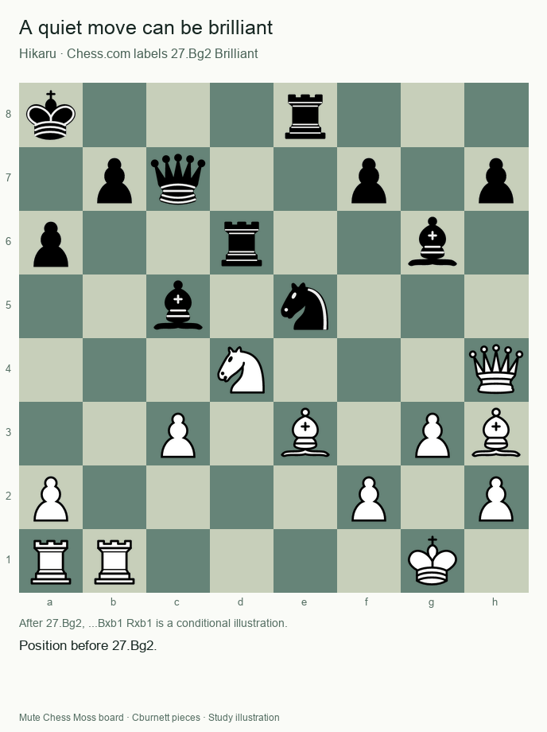
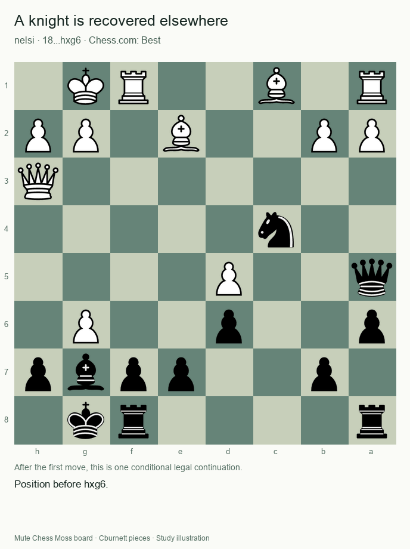
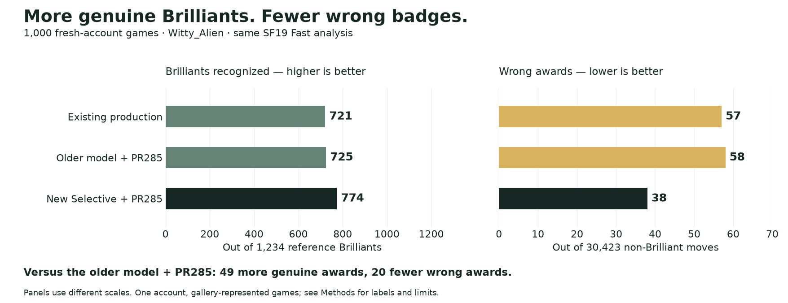

# Making Brilliant badges feel at home on Mute Chess

Chess.com’s Brilliant badge makes a good chess idea feel special. Our goal is to bring that experience to an open chess platform: recognize more genuine Brilliants while keeping undeserved badges low.

**We recommend Mute Selective: a small model we trained on chess moves labeled by Chess.com, combined with basic chess checks.**

Your browser downloads the model with the analysis code and runs it locally. Stockfish supplies the chess evaluations; the model uses those and facts about the position to decide whether to award Brilliant. It does not call ChatGPT or a remote classification service, and it does not learn from your games during play. The model and training code are openly published. En Croissant decides its Brilliant badge using rules written by its developers. Our model learns patterns from Chess.com’s labels.

**November 6 update:** [The new selective forest improves both recognition and wrong-award counts on a fresh account →](#november-6-2026-addendum-more-brilliants-fewer-wrong-badges)

## What we studied

The project examined **1,248 labeled moves from 654 games** by nelsi, hansen, KNVB, GothamChess and Hikaru, starting from En Croissant’s classifier.

The headline results below come from **400 test moves in 215 games that were not used to train the model**. Half were Chess.com Brilliants; half were explicitly non-Brilliant. The model and its threshold stayed unchanged throughout the assessment. We compared it with En Croissant on the same positions and engine analysis.

Chess.com does not publish its complete formula. Its [guidance](https://support.chess.com/en/articles/8572705-how-are-moves-classified-what-is-a-blunder-or-brilliant-etc) helped us identify relevant chess ideas, but our chosen system is not a reconstruction of that private formula.

## The approach we chose

- **Keep the move sound.** Current and previous completed engine checks must both support its quality.
- **Require a real piece offer.** The offered piece can be somewhere other than the piece that moved.
- **Learn from Chess.com examples.** We trained the small model using moves Chess.com called Brilliant and moves it did not. It considers material, piece offers, move quality and the position, then runs locally in the browser without changing during play.
- **Prefer convincing badges.** Both engine checks must clear the model’s fixed threshold. This does not add the separate History Rule or material-recovery guard as extra requirements.

## Quiet moves can be Brilliant—and still be missed

[Hikaru’s 27.Bg2](https://www.chess.com/analysis/game/live/186567991235/review?move=52) retreats a bishop while leaving a rook available. Chess.com calls it Brilliant, but the selective model misses it. That is a real cost of choosing fewer questionable badges. The illustrated **...Bxb1 Rxb1** replies are conditional, not claimed forced or played.

## An apparent sacrifice can be an ordinary trade

After [18...hxg6](https://www.chess.com/analysis/game/live/171488501692/review?move=35), **Bxc4 Qc5+** leads to material recovery elsewhere. Chess.com calls hxg6 Best. Mute Selective also withholds Brilliant, as it does for the [rook-recovery example](visuals/outputs/routine-hxg5.gif). These are checked model outcomes; the conditional animations illustrate the chess ideas, not the model’s internal reasoning.

## How closely do the badges match?

| Across 400 test moves | Mute Selective | En Croissant |
| --- | ---: | ---: |
| Brilliants correctly recognized | **112 / 200** | 53 / 200 |
| Undeserved Brilliant badges | **3 / 200** | 3 / 200 |

Other methods found more Brilliants but gave too many undeserved badges to justify choosing them. In a 200-move comparison, the History Rule recognized 78 Brilliants but wrongly awarded 13 badges. The selective model recognized 57 and wrongly awarded **2**; En Croissant recognized 27 and wrongly awarded 1.

**Adopt Mute Selective alongside its chess rules.** Next, train improved versions using more labeled examples, especially missed Brilliants and ordinary tactics that deserve no badge. The current test examples can become training data, but an improved model must then prove itself on different games it has never seen. The goal is to recognize more genuine Brilliants while keeping wrong awards low. The [exact algorithm](README.md) and [Methods](METHODS.md) explain sampling, uncertainty and limits. Mute Dev handles the app merge. Mobile Maia keeps its existing En Croissant-based classifier.

## November 6, 2026 addendum: more Brilliants, fewer wrong badges

**Our recommendation is now New Selective: the updated forest at a 0.83 cutoff, together with PR285’s complete-window confirmation fix.** It is a research recommendation, not a deployed change.

We followed the next step described above: train on more labeled moves, improve the forest recipe, freeze it, and check it on a different account. The development set grew to **6,293 moves**. We compared tree settings and how selective to be, keeping the basic chess checks and position features. The chosen forest has 128 trees. More generous settings recognized more Brilliants but added too many wrong badges for our preferred tradeoff.

The new model still runs locally in your browser. It is trained ahead of time; it does not learn while you play. Ordinary JavaScript evaluates its decision trees—there is no neural network, ONNX runtime, ChatGPT call, or remote classification service.

### A fresh account, using the site’s Fast analysis

We checked **1,000 games from Witty_Alien**, an account outside the model’s development set. No Witty_Alien examples were used to train the model or adjust its cutoff. All three versions analyzed the same complete games, including both players’ moves; the scores below count only Witty_Alien’s moves.

| On the same 1,000 games | Genuine Brilliants recognized | Wrong Brilliant awards |
| --- | ---: | ---: |
| Existing production version | 721 / 1,234 | 57 / 30,423 |
| Older model with PR285 | 725 / 1,234 | 58 / 30,423 |
| **New Selective with PR285** | **774 / 1,234** | **38 / 30,423** |

That is **62.7% of the reference Brilliants recognized**, with wrong awards on **0.125% of the non-Brilliant moves**. Compared with the older model using the same confirmation fix, New Selective found **49 more genuine Brilliants and gave 20 fewer wrong badges—about 34% fewer wrong awards**.

These are net improvements, not perfect agreement on every move. Against that same baseline, the new version gained 95 genuine awards and lost 46; it removed 27 wrong awards and added 7. It still missed **460** reference Brilliants.

The earlier En Croissant comparison above remains a separate historical result. It used saved SF18 research analysis; this update uses the site’s SF19 Fast path. **En Croissant was not tested on this Witty_Alien sample**, so the two studies should not be combined into a new head-to-head claim.

This is encouraging evidence for adopting **New Selective with PR285**, while keeping wrong awards low as we work toward broader coverage. It is one fresh account and a sample of games represented in its Brilliant gallery, not a promise of the same accuracy for every player. One previously seen position was excluded. [Methods and evidence](METHODS.md#november-6-2026-update-frozen-forest-and-fresh-account) explain the labels, sampling and limits.
