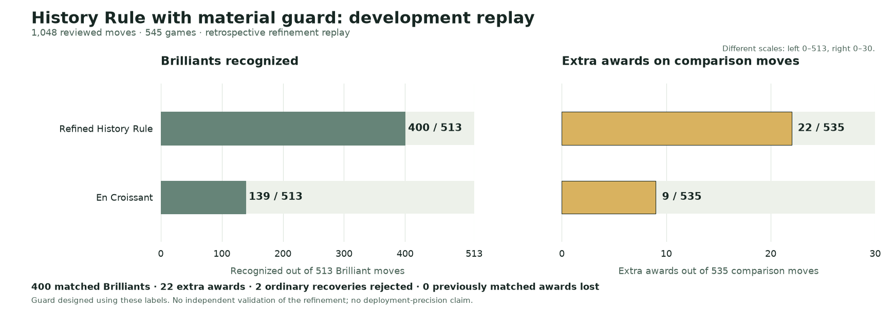
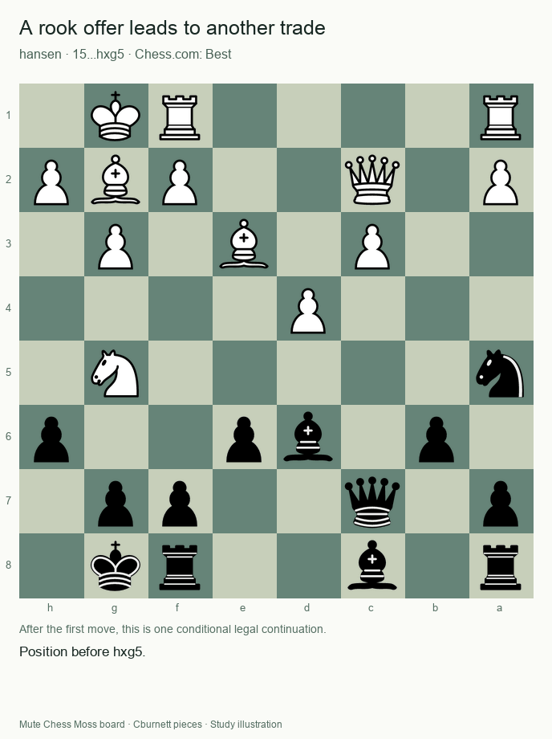

# Adopt the Mute History Rule—with a material-recovery guard

**We recommend the Mute History Rule with a narrow material-recovery guard.** It celebrates genuine sacrifice ideas while rejecting two ordinary recoveries that previously received extra badges.

Across **1,048 reviewed moves**, the refined rule retains **all 400 previously matched Chess.com Brilliants**, misses 113, and gives **22 extra awards** among 535 explicitly non-Brilliant moves. The guard removes two extras and changes no other decision in this replay.

**This is development evidence, not an independent accuracy test of the refinement.** The guard was designed using these positions and labels. It has **zero new unseen validation moves**. Preserving 400 matching awards here does not guarantee that no future Brilliant will be lost.

## What the evidence establishes

The corpus contains **1,048 moves from 545 games** across nelsi, hansen, KNVB, GothamChess and Hikaru. It supports two distinct evidence types:

| Evidence | Result | What it tests |
| --- | --- | --- |
| Refined rule: all 1,048 reviewed moves | **400 matches, 113 misses, 22 extras, 513 correct withholds** | Retrospective development replay |
| Frozen History Rule: separate 200-move test | **78 matches, 22 misses, 5 extras, 95 correct withholds** | Independent test of the rule **without the new guard** |
| Unseen test of the material guard | **Not yet available** | Needed to assess generalization of the refinement |

The frozen 200-move result remains **86.5% agreement**, **78% recognition** and **94.0% sample badge precision**. It recognized three times En Croissant’s 26 Brilliants, with five extras versus two. Applying the new guard to that same subset leaves three extras, but **that is retrospective reuse, not a revised untouched test score**. Neither result establishes 90% agreement or deployment precision.

## Two ordinary recoveries that should not earn Brilliant

After [nelsi’s 18...hxg6](https://www.chess.com/analysis/game/live/171488501692/review?move=35), White can take the knight with **Bxc4**. Black has **...Qc5+**, followed by **...Qxc4** after each legal defense. The illustrated **Kh1** is just one of four replies covered by the material check. The knight and bishop are traded; Black finishes a pawn ahead. Chess.com labels hxg6 Best, and the refined rule withholds Brilliant.

After [hansen’s 15...hxg5](https://www.chess.com/analysis/game/live/173517772799/review?move=29), **Bxa8** appears to win a rook. But **...Ba6** creates a threat against the other rook. The illustrated **Bg2 Bxf1 Rxf1** continuation returns material to balance. The check covers all 43 legal replies to Ba6, with different recovery captures where needed. Chess.com labels hxg5 Best; the refined rule now agrees.

Only each first move has the observed label. Subsequent moves are **conditional legal illustrations**, not asserted game continuations or forced choices. The recovery certificate covers defenses more broadly than the single animation, within its documented finite material model.

## How the classifier makes the call

The History Rule requires a legal piece offer, adequate engine-assessed quality and corroborating sacrifice or mating evidence. Current and previous completed engine checks must both pass. Its history check prevents an unchanged quiet follow-up earning another badge merely because an earlier awarded sacrifice remains available. New tactical ideas have documented exceptions.

The material guard is deliberately narrower than “material comes back, so no Brilliant.” It applies only to an eligible non-checking capture that leaves **all offered pieces unmoved and already exposed**. The opponent’s best after-position move must accept an eligible offer in **both completed engine windows**.

For every qualifying acceptance, the guard must find a quiet response covering **every legal defense** with a stable material-recovery capture. Its exact threshold, same-square recapture accounting and search caps are open in the [algorithm README](README.md). Missing evidence or exhausted limits cannot establish a veto. Newly created offers and moved-piece sacrifices are protected by these eligibility restrictions.

## Keep the genuine ideas

The guard preserves all previously matched Brilliants in the reviewed corpus, including [Hansen’s Bxh7+ example](visuals/outputs/fresh-bxh7.gif). It also preserves the development [quiet Bg2 idea](visuals/outputs/quiet-offer-bg2.gif), where a bishop retreat leaves a rook available. Recovery alone is not a generic reason to reject a tactical sacrifice.

We recommend this documented heuristic as a Mute policy, not a reconstruction of [Chess.com’s private formula](https://support.chess.com/en/articles/8572705-how-are-moves-classified-what-is-a-blunder-or-brilliant-etc). The balanced, challenging corpus and five established accounts do not establish beginner behavior or ordinary-game badge frequency. Game Review labels are comparison evidence; moves share games, limiting independent-move uncertainty estimates.

Adoption is recommended, **not claimed deployed**. Research evidence uses **SF18 at 300,000 requested nodes**. Native SF19 and varying browser budgets remain unvalidated. Mobile Maia stays on its existing En Croissant-based classifier. [Methods](METHODS.md), [exact rules](README.md) and preserved historical results make those boundaries inspectable.
