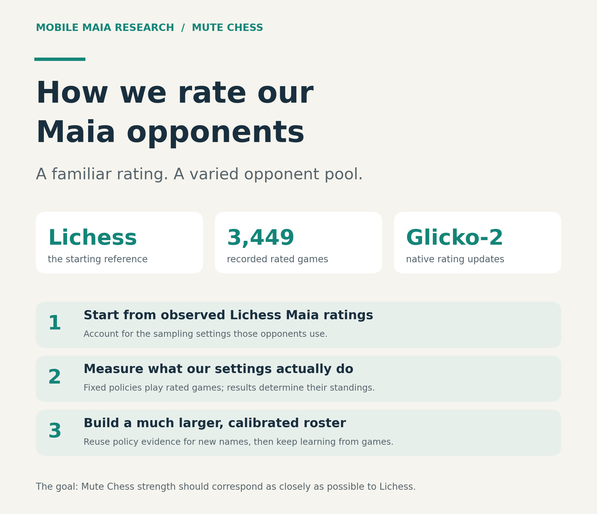
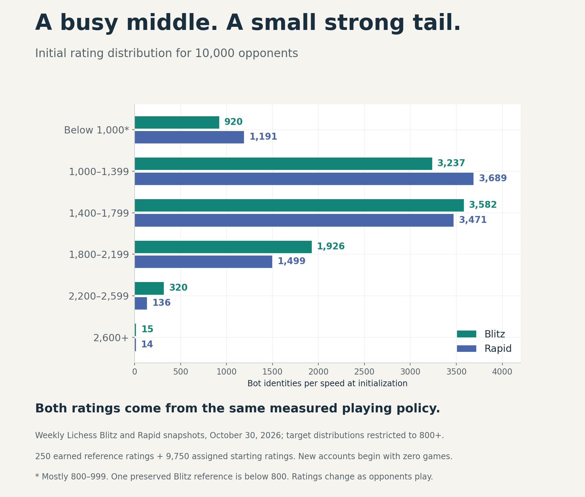

# How Mute Chess seeds bot ratings

Mute Chess needs useful starting ratings for many human-like Maia opponents.
This research starts from public Lichess Maia evidence, lets a varied reference
pool earn ratings through games, and reuses measured playing policies when
creating new identities.

**Start with the illustrated [reader report](REPORT.md).** The separate
[catalog method](CATALOG-METHOD.md) gives the exact assignment formula and
10,000-opponent allocation. Both are reader copies with links adapted for this
repository; their findings and numerical claims are unchanged.

The published evidence contains **3,449 rated games**, **250 reference
opponents established in both Blitz and Rapid**, and the inputs behind the
initial **9,750 research-seeded new identities**. New identities use a reference
estimate for the same effective playing policy and speed. They do not receive
copied game histories. Native Glicko-2 continues updating ratings after games.

The practical distinction matters: a Maia conditioning input such as 1600 is
not itself a measured playing rating. Temperature, Top-P, opening behavior and
history help define the policy whose strength was measured. The earlier fitted
predictor and smooth planning approximation are retained as research, but the
generated catalog uses direct measured-policy reuse.

## Read the evidence

| Publication | Purpose | Saved games |
| --- | --- | ---: |
| [Original seeding study](bot-strength-seeding-2026-10-31/REPORT.md) | Initial anchors, varied controls, frozen prediction procedures, evaluation and its limitations | 2,623 |
| [Rating-establishment study](bot-rating-establishment-2026-10-31/README.md) | Later establishment, retained reference ratings, numerical reproduction and catalog allocation | 826 |

Each archive includes the published data, PGNs, figures, source pins,
`SHA256SUMS` and existing verification/reproduction scripts. The two directories
are copied **byte for byte** from
[mobile-maia-research at 140e2eb](https://github.com/Dash1971/mobile-maia-research/tree/140e2eb411923930fb0d5950b92abf6f3c0166dd).
[SOURCE-PROVENANCE.json](../../SOURCE-PROVENANCE.json) records every source Git
blob and SHA-256 digest. The combined archived material is 35.7 MB; no new
calibration games, fitting or rating changes accompany this copy.

## What the results do not establish

Closed-pool games refine relative strength around the initial Lichess-based
anchor. They cannot independently prove that a human's Mute Chess rating equals
their Lichess rating. Native establishment removes a provisional marker under
the rating system's uncertainty rule; it does not mean a rating can no longer
change. Previously observed test configurations and inherited history also
limit the interpretation of the prediction evaluation.

The published reports retain these limitations and distinguish earned reference
ratings from assigned, **Research-seeded** new-account ratings. Earlier sampling,
history and opening studies remain in the original repository and are cited at
pinned source URLs by the reader copies. Historical archived Markdown retains
its original relative citations and checksums.

The original AGPL-3.0-only license is retained in [LICENSE](../../LICENSE).
This transfer was prepared with OpenAI Codex assistance; it is a publication
copy, not a new experiment or an independent revalidation of the original study.
